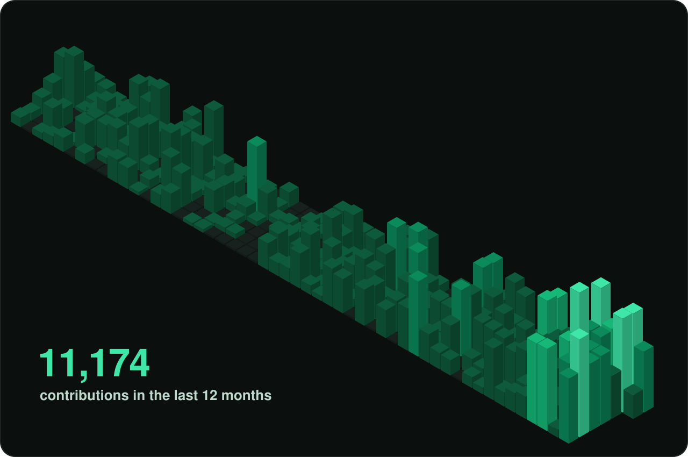

  

Founder of **[Grovlix](https://www.grovlix.com)**. We build growth apps that help Saudi e-commerce stores turn visitors into buyers on **Salla** and **Zid**.

## What I'm building

- **[PopupSnap](https://popupsnap.com)**: popups, lucky wheel, product badges and countdowns that turn browsers into buyers. 150+ ready-made templates.
- **[Product Studio](https://apps.salla.sa/ar/app/1361508646)**: shoppers customize products (necklaces, t-shirts and more) with a live preview, right in the store.
- **[InstaFeed](https://apps.salla.sa/ar/app/1452485821)**: your Instagram and TikTok posts, highlights and videos inside your store, always fresh.
- **[PopAuto](https://apps.salla.sa/ar/app/600352558)**: discounts, price changes and product visibility on autopilot, plus bulk edits from Excel.

## How I build

Small team, AI-native, shipping every day with

  
  
  
  
  
  
  

## The last 12 months

Most of my work ships from private repos, so this is the shape of it:

## Find me

[andrewazmi.com](https://www.andrewazmi.com) · [X @AndrewAzmi](https://x.com/AndrewAzmi) · [Grovlix on X](https://x.com/GrovlixHQ) · [Grovlix on YouTube](https://www.youtube.com/channel/UCro5v6ZCqzcqRWQ2C5ekaUA)

<picture>
  <source media="(prefers-color-scheme: dark)" srcset="./snake/github-snake-dark.svg">
  
</picture>
